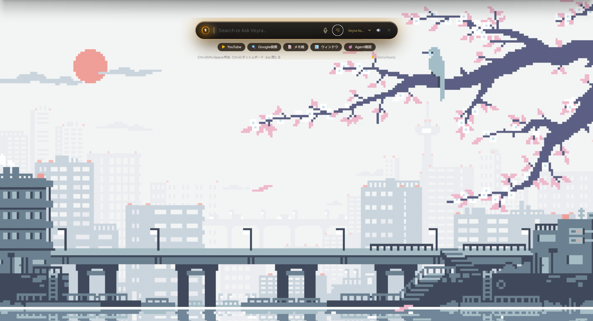
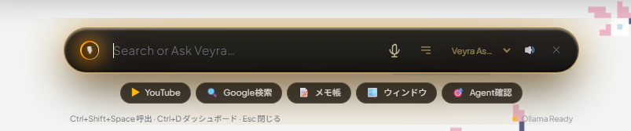

# Veyra (ヴェイラ)

<p align="center">
  <strong>日本語</strong> | <a href="./README.md">English</a>
</p>

> **Status:** Early Development / Experimental (Core MVP Operational)  
> **License:** MIT License  
> **Platform:** Windows 10 / 11 (64-bit)

<p align="center">
  
</p>

<p align="center">
  <strong>Windows OS 統合型・完全ローカル対応 自律 AI アシスタント＆タスクランタイム</strong><br>
  <em>「人の意図（Intent）を、検証された確実な実行（Verified Action）へ。」</em>
</p>

<p align="center">
  
  
  
  
  
  
</p>

---

## 📸 インターフェース

<p align="center">
  
</p>

### 1. 常駐フローティング・カプセル HUD (`Ctrl + Shift + Space`)
普段は画面上部に配置される Top-Anchored 透過ウィンドウです。レイヤード・アクリルガラス（Mica / Acrylic 風の `backdrop-filter: blur(48px)` とオパシティ設計）を採用し、グローバルショートカットで画面上部から滑らかに出現・格納されます。

### 2. プロジェクトダッシュボード・ドロワー (`Ctrl + D` または 右端の 📊 アイコン)
目標（Goal）の作成、要件・受入基準（AC）の確認、自律エージェントのステップ実行監視、Windows 自動化タスク、プロジェクト検証を行う際は、カプセル直下に 4タブ構成のドロワーが展開します。

---

## 🎬 自律実行ライフサイクル (Autonomous Execution Lifecycle)

Veyra は、ユーザーの自然言語による意図（Intent）を受け取ると、単なるテキスト応答にとどまらず、**「文脈収集 → モデル自動選定 (Smart Tiering) → 多段ツール実行 → 決定論的検証 → イベント永続化 → 音声フィードバック」** を自律サイクルとして完遂します：

<p align="center">
  
</p>

<details>
<summary>🔍 <strong>コアランタイムの決定論的完了ゲート抜粋（Rust: <code>crates/veyra-runtime/src/agent.rs</code>）</strong></summary>

```rust
// AI の自己申告「完了しました」を信用せず、決定論的検証（Command / File / AC Review）の
// 全パスを確認するまで Completed 状態への遷移を物理的に拒絶する厳格ゲート設計
let verification = self.verification_engine.verify_goal(goal).await?;

if verification.passed && !verification.checks.is_empty() {
    state_machine.transition(RuntimeState::Completed);
    event_store.append(EventType::GoalCompleted { goal_id, verification }).await?;
} else {
    // 1件でも失敗、または空チェック（未検証）の場合は自己修正・再計画（Replan）ループへ差し戻す
    state_machine.transition(RuntimeState::Failed { reason: verification.failure_summary() });
    self.replan_and_retry(goal, verification).await?;
}
```
</details>

---

## ⚡ 技術的特徴 (Technical Highlights)

- 🪟 **Mica / Acrylic レイヤード UI 設計**:
  - Windows デスクトップの作業領域を侵食しないコンパクトな常駐カプセルバーと、必要時にオンデマンドで開くプロジェクト管理ドロワー。
- 🧠 **マルチモデル・ハイブリッド運用 (Smart Tiering)**:
  - 日常会話・ツール要約・意図判定: 高速な **1.5B モデル (`qwen2.5:1.5b`)** で低遅延応答。
  - プログラミング・自律Agent・受入基準検証: 推論能力の高い **7B Coder (`qwen2.5-coder:7b`)** へ自動昇格。
  - ※ 外部 API（OpenAI / DeepSeek 等）を使用する場合は、指定された単一モデル（例: `gpt-4o-mini`）で全タスクを処理、またはローカル Ollama を併用したフォールバック構成が可能です。
- 📦 **コンテキスト・パッケージング (Context Packaging)**:
  - 単なる会話テキストの丸投げを排除。アクティブな Goal、受入基準（AC）、直近の Windows ツール実行履歴（成否・出力抜粋）、アクティブウィンドウ情報（Win32 API `GetForegroundWindow`）を構造化 JSON（[`ContextPackage`](./crates/veyra-core/src/context.rs)）として AI プロンプトに注入します。
- 🛡️ **検証済み自律実行 (Generate ≠ Done)**:
  - AI が自己申告した「完了」を信用せず、決定論的コマンド実行と受入基準チェックが実際に通過するまで完了状態（`Completed`）を許可しない厳格なランタイム状態管理。
- 🔒 **多層防御の権限サンドボックス (Permission Levels)**:
  - Windows ツール実行に対し、`read`（読取のみ）/ `low_risk`（安全なアプリ起動）/ `medium_risk` / `high_risk` / `critical` の権限階層を設け、不正なパス脱出（Path Traversal）や破壊的シェルの実行を Rust レイヤーで防御します。
- 🎙️ **デュアル音声エンジン (任意・オプション)**:
  - **STT**: ブラウザ Web Speech API による即時日本語文字起こし ＋ ローカル **Whisper (`whisper-rs`)** による高精度校正。
  - **TTS**: BERT 音素アライメントを特徴量とする end-to-end 音声合成 **Style-Bert-VITS2**（Windows 標準 SAPI 音声への自動フォールバック完備）。音声エンジンが未起動でもテキストのみで 100% 動作します。

---

## 🎮 キーバインド & ショートカット

| キー操作 | 動作 | 備考 |
|---|---|---|
| **`Ctrl + Shift + Space`** | **HUD 呼び出し / 格納** | メイン操作。エディタ等との衝突が少ない設計 |
| **`Ctrl + D`** | **ダッシュボード開閉** | Goals / Tools / Verification / Settings の展開 |
| **`Ctrl + Space`（長押し）** | **音声入力 (Push-to-Talk)** | 押下中録音、離すと送信（※下記キー衝突の注記参照） |
| **`Esc`** | **閉じる** | ドロワー展開時はドロワーのみ、HUD単体時はウィンドウ全体を非表示 |
| **`Enter`** | **送信 / 実行** | テキスト入力欄の確定 |

> ⚠️ **キーバインドの衝突に関する注意**:  
> `Ctrl + Space` は VS Code の IntelliSense 補完や一部の日本語 IME 切り替えと衝突する可能性があります。Veyra では他プロセスがホットキーをすでに登録していてもアプリがクラッシュしない安全登録設計を採用しています。音声入力は UI 上のマイクアイコンからも操作可能です。

---

## 🏗️ アーキテクチャと検証パイプライン

### 1. タスク実行 & 検証フロー

```text
Human Intent → Goal (Requirements / AC) → Context Package → Smart Tiering
             → Multi-Step Tool Execution → Verification Engine → Event Log (SQLite)
```

### 2. 検証エンジン (Verification Engine) の判定仕様
検証エンジンは、以下の多段チェックを自律実行します：
1. **Command Check**: プロジェクト構成（Rust: `cargo check`, Node: `npm test` 等）を自動判別し、ビルド/テストコマンドを実行してプロセス終了コード `0` を検証。
2. **File Check**: 生成・変更されたファイルが存在し、期待される文字列を含んでいるか（サンドボックス脱出がないか）を検証。
3. **AiReview**: 受入基準（AC）の各項目を満たしているかを AI が自己レビュー（`{ passed: bool, summary: string }`）。
4. **完了ゲート**: チェック数が 0 件（Unverified）または 1 件でも失敗した場合、完了状態（`Completed`）への遷移は拒否され、`RuntimeState::Failed` を経て再計画（Replan）ループへ移行します。

### 3. Event Sourcing による状態永続化
チャット履歴だけでなく、Goal の作成・変更、ツールの実行ログ（成否・引数）、ユーザーフィードバックはすべて SQLite の `events` テーブルに追記専用（Append-only）で記録されます。  
状態の復元は、過去のイベント列を純粋関数 `Projector::project(&events)` に通すことで決定論的に `ProjectState` を再構築します。

---

## 📂 Repository Layout

```text
crates/
  veyra-core/     ドメイン型定義: Goal, Requirement, AcceptanceCriterion, ContextPackage, Event, State
  veyra-store/    SQLite 永続化, Append-only イベントログ, Projector (イベントから状態を純粋復元)
  veyra-runtime/  ステートマシン, アシスタント多段実行 (AssistantRunner), 自律Agent (AgentRunner), 検証エンジン
  veyra-ai/       AI ゲートウェイ (Ollama, OpenAI 互換 API プロバイダ, Smart Tiering ルーター)
  veyra-tools/    Windows ツールランタイム (プロセス起動, ファイル操作, ブラウザ, 権限サンドボックス)
  veyra-voice/    ローカル Whisper STT (whisper.cpp) ＆ Style-Bert-VITS2 音声合成クライアント
src-tauri/        Tauri 2 デスクトップ常駐シェル (Win32 API, グローバルショートカット, システムトレイ)
src/              React 19 + TypeScript + TailwindCSS によるカプセル HUD & ダッシュボード UI
docs/             技術レビュー確定レポート (DESIGN_REVIEW_2026-09-29.md) 及び開発資料
```

---

## 🛠️ 前提条件 & 2つのインストールパターン

### 必須システム環境
- **OS**: Windows 10 / 11 (64-bit)
- **Rust**: 1.80+ (stable, `x86_64-pc-windows-msvc`)
- **Node.js**: v18.0+ (推奨 v20+)
- **Microsoft C++ Build Tools**: Visual Studio Build Tools（インストール時に **「Desktop development with C++（C++ によるデスクトップ開発）」** ワークロードに必ずチェックを入れてください。Rust MSVC ツールチェーンのリンクに必須です）
- **WebView2 Runtime**: Windows 11 標準搭載（Windows 10 で未導入の場合は Evergreen Bootstrapper をインストール）
- **Tauri CLI**: プロジェクトの `devDependencies` に含まれているため、`cargo-tauri` のグローバルインストールは不要です（`npm run tauri` 経由で実行されます）。

### LLVM / libclang (ローカル Whisper ビルド時に必要)
`whisper-rs` の C++ バインディング生成に `libclang` が必要です：
```powershell
winget install LLVM.LLVM
[System.Environment]::SetEnvironmentVariable("LIBCLANG_PATH", "C:\Program Files\LLVM\bin", "User")
```

---

### 📦 インストール設定の選択（2パターン）

Veyra は、利用者の利用言語・環境に合わせて 2 つのセットアップパターンを提供しています。

```
┌───────────────────────────────────────────────┐
│              インストール パターン選択        │
├──────────────────────┬────────────────────────┤
│ パターン A: 日本語環境 │ パターン B: 英語/Global │
│ ・UI: 日本語表記     │ ・UI: English          │
│ ・AI: Qwen2.5 (ローカル)│ ・AI: OpenAI / DeepSeek │
│ ・音声: Style-Bert-VITS2│ ・音声: SAPI / Whisper  │
└──────────────────────┴────────────────────────┘
```

#### 【パターン A】完全ローカル・日本語最適化セットアップ（推奨）
日本語の自然言語指示・日本語音声合成・ローカル完結を重視する構成です。

1. **リポジトリのクローン & 移動**:
   ```bash
   git clone https://github.com/your-username/Veyra.git
   cd Veyra
   ```
2. **推奨モデルのダウンロード (Ollama)**:
   ```bash
   ollama pull qwen2.5:1.5b       # 意図判定・高速アシスタント用
   ollama pull qwen2.5-coder:7b   # 自律コーディング・受入基準検証用
   ```
3. **起動 (ビルド不要で設定なし即時動作)**:
   ```bash
   npm install
   npm run tauri dev
   ```
   *(※ 外部 API キーを設定しない場合、Veyra は自動的にローカル日本語モデルへルーティングされます)*

---

#### 【パターン B】グローバル・英語 / 外部 API 最適化セットアップ
英語での対話、または DeepSeek や OpenAI 等の高性能クラウドモデルを使用する構成です。

1. **リポジトリのクローン & 移動**:
   ```bash
   git clone https://github.com/your-username/Veyra.git
   cd Veyra
   ```
2. **環境変数ファイルの作成 (`.env`)**:
   ```bash
   cp .env.example .env
   ```
3. **`.env` の編集（APIキー設定）**:
   ```ini
   # OpenAI または DeepSeek の API キーを設定
   OPENAI_API_KEY=sk-xxxxxxxxxxxxxxxxxxxxxxxxxxxxxxxx
   OPENAI_BASE_URL=https://api.openai.com/v1     # DeepSeek: https://api.deepseek.com/v1
   OPENAI_MODEL=gpt-4o-mini                     # deepseek-chat, llama-3.3-70b-versatile 等
   ```
4. **起動**:
   ```bash
   npm install
   npm run tauri dev
   ```

---

### 本番バイナリのビルド
```bash
npm run build
npm run tauri build
```
ビルド完了後、`target/release/veyra-app.exe` に単体常駐バイナリが生成されます。

---

## 🎙️ Voice Setup (Optional / 任意)

> **Note**: 音声合成・認識サーバーが未起動でも、テキスト対話・ツール実行・自律エージェントは **100% 完全に機能** します。

### TTS — Style-Bert-VITS2 サーバー
VITS 基盤の日本語音声合成を利用する場合、ローカルまたはネットワーク上のサーバーを起動します：
```bash
cd <path-to>/Style-Bert-VITS2
# model_assets/ 配下に好みのキャラクターモデルを配置して起動
python server_fastapi.py --port 5000
```
- Veyra は HTTP（デフォルト: `http://127.0.0.1:5000/voice`）で通信します。
- サーバーが未起動の場合は、自動的に Windows 標準の音声合成（SAPI / Web Speech）へ安全にフォールバックします。

### STT — whisper.cpp
初回の音声入力時に、公式 whisper.cpp 配布リポジトリから ggml モデル（デフォルト: `tiny` 約 75MB）が自動ダウンロードされ、`%LOCALAPPDATA%\veyra\models` にキャッシュされます。

---

## 📖 取扱説明書 & カスタマイズガイド

モデル差し替えの詳細手順、外部 API（DeepSeek, OpenAI）の接続設定、自作 Windows ツールの追加方法などは、完全マニュアルをご覧ください：

- 👉 **[MANUAL.ja.md（Veyra 取扱説明書・カスタマイズ完全ガイド - 日本語）](./MANUAL.ja.md)**
- 👉 **[MANUAL.md（Comprehensive Customization Manual - English）](./MANUAL.md)**

---

## 🗺️ マイルストーン & ロードマップ

| Milestone | 内容 | 状態 |
|---|---|---|
| ✅ M1 | コアドメイン型、SQLite イベントストア、Projector、ランタイムステートマシン | 完了 |
| ✅ M2 | Tauri 2 デスクトップ常駐シェル ＋ 基本 IPC 配線 | 完了 |
| ✅ M3 | テキスト対話ループ（意図判定 → Goal 抽出 → イベント永続化） | 完了 |
| ✅ M4 | 検証エンジン（コマンド / ファイル / AI レビュー）＋ 有界エージェントループ | 完了 |
| ✅ M5 | 音声パイプライン（Push-to-talk → Whisper STT → Style-Bert-VITS2 TTS） | 完了 |
| ✅ M6 | アシスタント多段実行 ＆ Windows ツールランタイム（プロセス、ファイル、ブラウザ、ウィンドウ管理） | 完了 |
| ✅ M7 | 常駐型フローティング HUD: システムトレイ常駐、`Ctrl+Shift+Space` スライド出現、SiriOrb | 完了 |
| 🔄 M8+ | 分散エージェント間通信プロトコル連携（[Agent Protocol / NousResearch Hermes](https://github.com/NousResearch)）、画面理解（Vision/VLM）、カレンダー・通知連携 | 計画中 |
