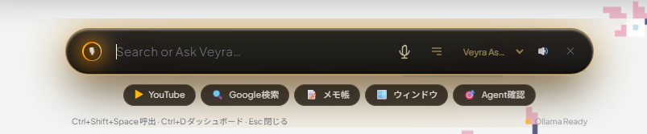

# Veyra

<p align="center">
  <a href="./README.ja.md">日本語 (Japanese)</a> | <strong>English</strong>
</p>

> **Status:** Early Development / Experimental (Core MVP Operational)  
> **License:** MIT License  
> **Platform:** Windows 10 / 11 (64-bit)

<p align="center">
  
</p>

<p align="center">
  <strong>Native Windows OS-Integrated, Fully Local Autonomous AI Assistant & Verified Task Runtime</strong><br>
  <em>"Turning Human Intent into Deterministically Verified Action."</em>
</p>

<p align="center">
  
  
  
  
  
  
</p>

---

## 📸 Interface

<p align="center">
  
</p>

### 1. Resident Floating Capsule HUD (`Ctrl + Shift + Space`)
A top-anchored, translucent HUD resting unobtrusively at the upper edge of your desktop. Crafted with layered acrylic aesthetics (`backdrop-filter: blur(48px)` with calibrated opacity) that smoothly slides in and out via global hotkeys.

### 2. Project Dashboard Drawer (`Ctrl + D` or Top-Right 📊 Icon)
When creating goals, defining requirements and Acceptance Criteria (AC), supervising multi-step autonomous agent runs, inspecting Windows automation tools, or verifying project consistency, a comprehensive 4-tab drawer slides down directly from the capsule.

---

## 🎬 Autonomous Execution Lifecycle

When receiving a natural-language command, Veyra executes a full closed loop: **Context Gathering → Smart Tiering Model Selection → Multi-Step Tool Execution → Deterministic Verification → Event Sourcing Persistence → Audio Synthesis**:

<p align="center">
  
</p>

<details>
<summary>🔍 <strong>View Core Runtime's Deterministic Completion Gate (Rust: <code>crates/veyra-runtime/src/agent.rs</code>)</strong></summary>

```rust
// Rejecting AI self-reported completion: The state machine physically denies transition
// to Completed until all deterministic checks (Command / File / AC Review) are verified.
let verification = self.verification_engine.verify_goal(goal).await?;

if verification.passed && !verification.checks.is_empty() {
    state_machine.transition(RuntimeState::Completed);
    event_store.append(EventType::GoalCompleted { goal_id, verification }).await?;
} else {
    // If any check fails or is unverified (empty checks), route back to self-correction loop
    state_machine.transition(RuntimeState::Failed { reason: verification.failure_summary() });
    self.replan_and_retry(goal, verification).await?;
}
```
</details>

---

## ⚡ Technical Highlights

- 🪟 **Mica / Acrylic Layered Architecture**:
  - Non-intrusive floating pill HUD combined with an on-demand project dashboard drawer, preserving full desktop workspace.
- 🧠 **Multi-Model Hybrid Tiering (Smart Tiering)**:
  - Daily conversational intent & tool summarization: Ultra-fast **1.5B model (`qwen2.5:1.5b`)** with low latency.
  - Complex programming, autonomous agent planning & AC verification: Auto-promoted to high-capacity **7B Coder (`qwen2.5-coder:7b`)**.
  - *Cloud API support*: Seamless fallback to OpenAI / DeepSeek / Groq endpoints when configured.
- 📦 **Context Packaging (Plan §18)**:
  - Eliminates raw text dumping. Injects active Goal, Acceptance Criteria (AC), recent tool invocation history (success/failure excerpts), and foreground window telemetry (Win32 `GetForegroundWindow`) as structured JSON ([`ContextPackage`](./crates/veyra-core/src/context.rs)).
- 🛡️ **Verified Autonomous Execution (Generate ≠ Done)**:
  - Enforces deterministic exit criteria. State transitions to `Completed` require non-empty passed checks. Empty checks default to `Unverified` and trigger replanning.
- 🔒 **Multi-Layered Permission Sandbox**:
  - Windows tool execution is governed by `Read` / `LowRisk` / `MediumRisk` / `HighRisk` / `Critical` policies, preventing path traversal and arbitrary destructive execution at the Rust layer.
- 🎙️ **Dual Audio Architecture (Optional)**:
  - **STT**: In-browser real-time Web Speech API transcription + local **Whisper (`whisper-rs`)** deterministic correction.
  - **TTS**: High-fidelity BERT-aligned synthesis with **Style-Bert-VITS2** (with graceful fallback to Windows native SAPI). Fully operational in text-only mode when audio engines are offline.

---

## 🎮 Keybindings & Shortcuts

| Hotkey | Action | Notes |
|---|---|---|
| **`Ctrl + Shift + Space`** | **Toggle Capsule HUD** | Primary trigger; engineered to prevent IDE hotkey conflicts |
| **`Ctrl + D`** | **Toggle Dashboard Drawer** | Expands Goals / Tools / Verification / Settings |
| **`Ctrl + Space` (Hold)** | **Push-to-Talk Voice Input** | Records while held, transcribes on release (safe registration) |
| **`Esc`** | **Dismiss / Close** | Closes drawer if open; hides HUD if drawer is closed |
| **`Enter`** | **Submit / Execute** | Confirms text input |

> ⚠️ **Hotkey Conflict Mitigation**:  
> `Ctrl + Space` can occasionally conflict with VS Code IntelliSense or IME mode switches. Veyra registers hotkeys gracefully without crashing if another process holds ownership. Voice input can also be triggered directly via the UI microphone icon.

---

## 🏗️ Architecture & Verification Pipeline

### 1. Task Execution & Verification Flow

```text
Human Intent → Goal (Requirements / AC) → Context Package → Smart Tiering
             → Multi-Step Tool Execution → Verification Engine → Event Log (SQLite)
```

### 2. Verification Engine Specification
Compliant with Plan §19, the engine executes multi-tier deterministic checks:
1. **Command Check**: Automatically inspects project structure (Rust: `cargo check`, Node: `npm test`, etc.) and verifies process exit code `0`.
2. **File Check**: Asserts generated/modified file paths exist, reside within sandbox boundaries, and match content invariants.
3. **AiReview**: Structured model review validating acceptance criteria (`{ passed: bool, summary: string }`).
4. **Completion Gate**: Zero checks (empty/unverified) or any failed check triggers `RuntimeState::Failed` and redirects to the replanning loop.

### 3. State Persistence via Event Sourcing
All domain state transitions—Goal mutations, tool execution telemetry, and user feedback—are persisted to an append-only SQLite `events` table. State is reconstructed deterministically by replaying event streams through `Projector::project(&events)`.

---

## 📂 Repository Layout

```text
crates/
  veyra-core/     Domain models: Goal, Requirement, AcceptanceCriterion, ContextPackage, Event, State
  veyra-store/    SQLite persistence, Append-only event store, Projector state restoration
  veyra-runtime/  State machines, Multi-step AssistantRunner, Autonomous AgentRunner, Verification Engine
  veyra-ai/       AI gateway (Ollama, OpenAI-compatible API providers, Smart Tiering router)
  veyra-tools/    Windows tool runtime (Process spawning, FS operations, Browser control, Sandbox)
  veyra-voice/    Local Whisper STT (whisper.cpp) & Style-Bert-VITS2 TTS client
src-tauri/        Tauri 2 desktop shell (Win32 APIs, Global shortcuts, System tray)
src/              React 19 + TypeScript + TailwindCSS HUD & Dashboard drawer UI
docs/             Architecture verification report (DESIGN_REVIEW_2026-09-29.md) and development records
```

---

## 🛠️ Prerequisites & Dual Setup Options

### System Prerequisites
- **OS**: Windows 10 / 11 (64-bit)
- **Rust**: 1.80+ (stable, `x86_64-pc-windows-msvc`)
- **Node.js**: v18.0+ (v20+ recommended)
- **Microsoft C++ Build Tools**: Visual Studio Build Tools (Ensure **"Desktop development with C++"** workload is checked during installation; required for Rust MSVC linkers)
- **WebView2 Runtime**: Pre-installed on Windows 11 (Use Evergreen Bootstrapper for Windows 10 if missing)
- **Tauri CLI**: Included in project `devDependencies` (`npm run tauri` handles execution)

### LLVM / libclang (Required for local Whisper compilation)
`whisper-rs` requires `libclang` to generate C++ FFI bindings:
```powershell
winget install LLVM.LLVM
[System.Environment]::SetEnvironmentVariable("LIBCLANG_PATH", "C:\Program Files\LLVM\bin", "User")
```

---

### 📦 Choose Your Setup Pattern (2 Options)

```
┌────────────────────────────────────────────────────────┐
│             Setup Pattern Selection                    │
├──────────────────────────┬─────────────────────────────┤
│ Pattern A: Japanese Env  │ Pattern B: Global / English │
│ • UI: Japanese labels    │ • UI: English labels        │
│ • AI: Qwen2.5 (Local)    │ • AI: OpenAI / DeepSeek     │
│ • Voice: Style-Bert-VITS2│ • Voice: SAPI / Whisper     │
└──────────────────────────┴─────────────────────────────┘
```

#### [Pattern A] Fully Local & Japanese-Optimized Setup (Recommended for JP Users)
Tailored for Japanese natural-language instructions, Japanese voice synthesis, and 100% offline privacy:

1. **Clone Repository**:
   ```bash
   git clone https://github.com/Yato-Works/Veyra.git
   cd Veyra
   ```
2. **Pull Recommended Models (Ollama)**:
   ```bash
   ollama pull qwen2.5:1.5b       # Intent classification & low-latency assistant
   ollama pull qwen2.5-coder:7b   # Autonomous coding & verification
   ```
3. **Launch**:
   ```bash
   npm install
   npm run tauri dev
   ```
   *(Without an `.env` file, Veyra automatically routes all requests to local Ollama)*

---

#### [Pattern B] Global / English & External Cloud API Setup
Tailored for English conversations or high-parameter cloud models (DeepSeek, OpenAI, Groq):

1. **Clone Repository**:
   ```bash
   git clone https://github.com/Yato-Works/Veyra.git
   cd Veyra
   ```
2. **Create Environment File (`.env`)**:
   ```bash
   cp .env.example .env
   ```
3. **Configure API Credentials**:
   ```ini
   # Configure external OpenAI-compatible endpoints
   OPENAI_API_KEY=sk-xxxxxxxxxxxxxxxxxxxxxxxxxxxxxxxx
   OPENAI_BASE_URL=https://api.openai.com/v1     # DeepSeek: https://api.deepseek.com/v1
   OPENAI_MODEL=gpt-4o-mini                     # deepseek-chat, llama-3.3-70b-versatile, etc.
   ```
4. **Launch**:
   ```bash
   npm install
   npm run tauri dev
   ```

---

### Production Binary Build
```bash
npm run build
npm run tauri build
```
Once completed, the standalone resident binary will be generated at `target/release/veyra-app.exe`.

---

## 🎙️ Voice Setup (Optional)

> **Note**: Even if voice servers are not running, all text interactions, Windows tool execution, and autonomous agent loops remain **100% fully functional**.

### TTS — Style-Bert-VITS2 Server
For high-fidelity Japanese neural voice synthesis:
```bash
cd <path-to>/Style-Bert-VITS2
# Place your character models in model_assets/
python server_fastapi.py --port 5000
```
- Communicates via HTTP (`http://127.0.0.1:5000/voice` by default).
- Automatically falls back to Windows SAPI speech synthesis if offline.

### STT — whisper.cpp
On first voice invocation, the official ggml model (`tiny`, ~75MB) is automatically downloaded and cached in `%LOCALAPPDATA%\veyra\models`.

---

## 📖 Comprehensive Manuals

For model swapping guides, custom Windows tool development, and cloud API integration:

- 👉 **[MANUAL.md (Comprehensive Customization Manual - English)](./MANUAL.md)**
- 👉 **[MANUAL.ja.md (Veyra 取扱説明書・カスタマイズ完全ガイド - 日本語)](./MANUAL.ja.md)**

---

## 🗺️ Milestones & Roadmap

| Milestone | Scope | Status |
|---|---|---|
| ✅ M1 | Core domain models, SQLite event store, Projector, Runtime state machine | Completed |
| ✅ M2 | Tauri 2 desktop resident shell & IPC wiring | Completed |
| ✅ M3 | Conversational loop (Intent detection → Goal extraction → Event persistence) | Completed |
| ✅ M4 | Verification Engine (Command / File / AI Review) + Bounded Agent Loop | Completed |
| ✅ M5 | Voice pipeline (Push-to-talk → Whisper STT → Style-Bert-VITS2 TTS) | Completed |
| ✅ M6 | Assistant multi-step execution & Windows tool runtime (Process, FS, Browser, Window) | Completed |
| ✅ M7 | Resident Floating HUD: System tray, `Ctrl+Shift+Space` slide-in, SiriOrb | Completed |
| 🔄 M8+ | Distributed agent interoperability ([Agent Protocol / NousResearch Hermes](https://github.com/NousResearch)), Screen understanding (VLM), Calendar/notifications | Planned |
